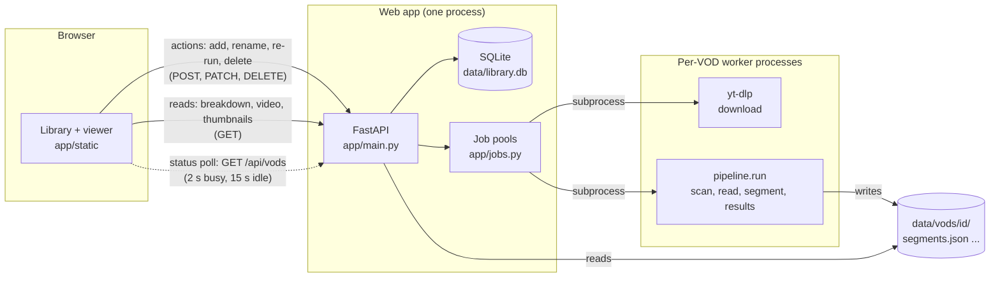
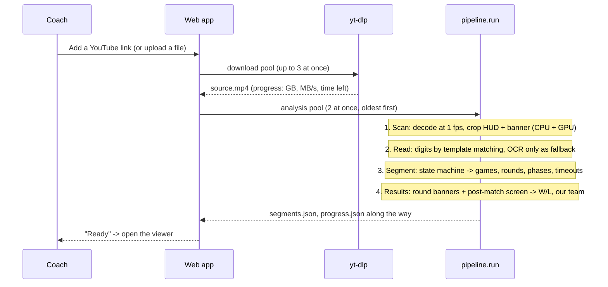
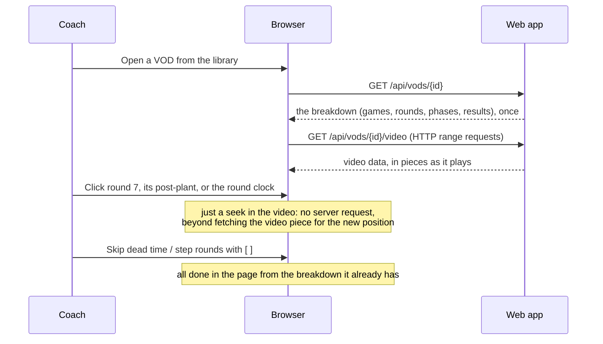

# 1. Overview

## The problem

A Valorant coach records long sessions (scrims, practice, tournament streams) of 1 to 3 hours. The
useful moments are inside specific rounds: the execute in round 7, what happened after the plant in
round 19, the timeout talk. Scrubbing a 3-hour video to find them is slow.

Coach Dnunz watches the video once and produces an index: games, rounds, and the phases inside each
round (buy phase, live, post-plant, round end), plus timeouts, scores, and who won each round and
game. The viewer is built around that index, so the coach jumps to "game 2, round 7, post-plant"
instead of scrubbing.

Everything runs locally: no cloud, no accounts, no uploading multi-GB videos anywhere.

## The key idea: read the HUD, not the game

Understanding gameplay from pixels is hard. Valorant's HUD (heads-up display) already states what
phase the game is in, in a fixed place, in a fixed font:

```
          ┌──────── top centre of the screen ────────┐
  [left score]  [ round timer / spike icon ]  [right score]
                    WON / LOST banner (round end)
```

- The **round timer** counts down from ~0:30 in the buy phase, restarts at ~1:40 when the round
  goes live, and is replaced by a **spike icon** after a plant.
- A short **0:06 countdown** and a **score change** mark the round end.
- A timer **frozen** for several seconds is a timeout.
- A **WON / LOST** banner (or CLUTCH, FLAWLESS, ACE, THRIFTY) appears at each round end.
- A **VICTORY / DEFEAT** summary screen often appears after a match.

So the computer-vision part reduces to: read a few small, well-defined regions about once a second,
reliably and fast. The rest is logic over a time series.

> Lesson: before reaching for a model, look for the signal the application already displays. A
> game HUD, a broadcast scoreboard, a UI status bar or a timestamp overlay turns a perception problem
> into a reading problem.

## Architecture



- **Frontend** (`app/static`): plain HTML/CSS/JS, no build step. It talks to the server in three
  ways: **actions** when you click something (add, rename, re-run, delete), **reads** when you look
  at something (a VOD's breakdown, the video itself, thumbnails), and a **status poll** that catches
  up on work the server does on its own (downloads, analyses, background updates). See chapter 6.
- **Web app** (`app/main.py`, `app/jobs.py`, `app/db.py`): FastAPI serves the API, the video files
  (with HTTP range requests, so seeking works) and the frontend. Job pools run downloads and
  analyses.
- **Pipeline** (`pipeline/`): the computer-vision part. Runs as a separate process per VOD, so a
  crash or a memory spike cannot take the web app down.
- **Launcher** (`launch.py`, `start.*`): one-command setup and start; a tray app on Windows.

## The life of one VOD: adding it



## Reviewing a VOD

Once a VOD is processed, reviewing it barely involves the server beyond streaming the video:



Everything interactive in the viewer (which round you are in, the phase buttons, the round clock,
skipping dead time) is computed in the browser from the breakdown it fetched once.

## Cost per step

Per-step cost for the 1h45m sample (about 148 s in total):

| Step | Time | Mostly |
|---|---|---|
| 1. Scan (decode + crop) | ~125 s | CPU, plus the GPU's video decoder |
| 2. Read the HUD | ~16 s | CPU (multiprocess OCR fallback) |
| 3. Segment | < 1 s | Python |
| 4. Round and game results | ~5 s | CPU (OCR on a few frames) |

Decoding dominates. That is typical for video CV once the per-frame work is cheap: **the
bottleneck moves to getting pixels out of the video file.** Chapter 2 is about that.

## Files on disk

```
data/
  library.db                 SQLite: one row per VOD (name, status, progress, dates)
  coach.log, coach.port      Windows tray app: its log, and the port it listens on
  vods/<id>/
    source.mp4               the video (downloaded, uploaded, or a symlink)
    hud.npz                  scan output: HUD crops (deleted when the analysis finishes)
    readings.jsonl           one JSON line per second: timer, scores, spike, decimal flag
    segments.json            the result: games, segments, pauses (see chapter 4)
    progress.json, run.log   live progress and the worker's log
    thumb.jpg                library card thumbnail, from the first live round
```

Keeping the intermediate `readings.jsonl` was worth it many times: the segmenter and the results
step can be re-run on old VODs in under a second, without decoding the video again.

> Lesson: persist the expensive intermediate representation (here, per-second readings), not just
> the final answer. It makes iterating on the cheap later stages nearly free.
