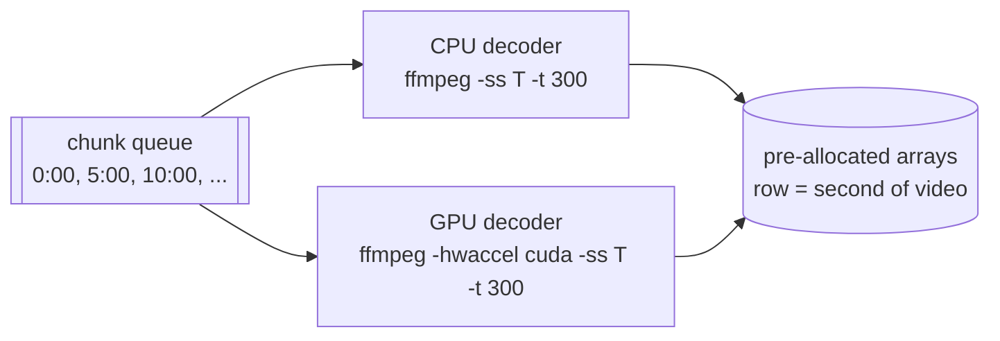

# 2. Reading video fast

Code: `pipeline/extract_hud.py`. Output: `hud.npz`, a few small image crops per second of video.

## Only decode what you need, and only keep what you read

A 3-hour 1080p60 recording is 648,000 frames. The HUD changes about once a second, so the pipeline
**samples 1 frame per second** and **keeps only small crops**:

```
ffmpeg -i source.mp4 -an \
       -vf "fps=1,scale=1920:1080:flags=bicubic,crop=800:265:560:0" \
       -f rawvideo -pix_fmt rgb24 -
```

- `fps=1` keeps one frame per second. ffmpeg still has to decode every frame (each frame depends on
  the ones before it), but everything after the decoder only runs on the kept frames.
- `scale=1920:1080` maps **any** input resolution onto 1080p coordinates, so every crop box below is
  defined once, in 1080p pixels.
- `crop=800:265:560:0` keeps an 800 x 265 strip at the top centre: the timer, both scores, and the
  round-result banner just below them.
- `rawvideo rgb24` to stdout: Python reads fixed-size frames (800 x 265 x 3 bytes) from the pipe
  into NumPy arrays, with no image files in between.

Inside that strip, sub-crops (x, y, w, h):

| Crop | Box | Used for |
|---|---|---|
| timer | (330, 8, 140, 87) | round timer, spike icon, decimal "31.67" pill |
| left score | (230, 25, 70, 50) | one team's rounds won |
| right score | (505, 25, 70, 50) | the other team's |
| banner | (260, 145, 280, 120) | WON / LOST / CLUTCH word (kept only when it looks present) |

The scan stores the three HUD crops for every second. The banner crop is kept only for frames that
pass a cheap check (two or more white, letter-sized blobs, chapter 5) and only in grey, which cut
peak memory from 774 MB to 559 MB on the sample.

**Sampling at 1 fps instead of 2 fps** was a free win: the original pipeline extracted at 2 fps but
only ever read every second frame. Halving it gave identical readings and halved memory
(~1 GB to ~488 MB per 1h45m analysis).

> Lesson: decide the sampling rate from the signal (a timer that changes once a second needs
> about 1 Hz), and crop as early as possible. Most of a frame is irrelevant.

## Where the time goes: decoding

Once reading became cheap (chapter 3), decoding was ~85% of the pipeline. Measurements on 10
minutes of the sample video (36,000 frames at 60 fps):

| Method | Wall time | CPU time used | Notes |
|---|---|---|---|
| CPU decode (libavcodec, 16 threads) | 16.6 s (~36x real time) | ~168 CPU-s | saturates all cores |
| GPU decode (NVDEC, `-hwaccel cuda`) | 27-28 s (~21x real time) | ~19 CPU-s | 9x less CPU |
| CPU, `-skip_loop_filter all` | 12.2 s | | **18% of readings changed** (blockier digits) |
| CPU, `-skip_frame bidir` | 13.5 s | | 1.7% of readings changed; no gain on streams without B-frames |
| 720p source (re-encoded test) | 9.8 s | | digits read much worse (40% of scores lost) |

Two surprises:

1. **The GPU was slower than the CPU** for a single video. NVIDIA's NVDEC is a fixed-function
   decoder chip; a fast desktop CPU decoding H.264 on 16 threads beats it. An RTX 3070/3080 has a
   decoder of a similar class, so this holds there too.
2. **But the GPU barely uses the CPU** (19 vs 168 CPU-seconds). That makes it valuable as an
   *extra* decoder running next to the CPU, rather than a replacement.

The shortcuts that skip decoding work (`skip_loop_filter`, `skip_frame`) or lower the resolution
(720p) were all rejected because they changed what the digit reader saw. Every optimisation was
checked against the readings it produced, not just its speed.

> Lesson: measure wall time **and** CPU time. A slower device that frees the CPU can still raise
> total throughput.

## CPU + GPU together: a shared chunk queue

First attempt: two "lanes", one VOD decoding on the CPU and another on the GPU at the same time.
Result for two copies of the 1h45m VOD: CPU lane 200 s, GPU lane 349 s, only ~10% better than doing
them one after the other, because the GPU lane is the slow one.

Final design: **cut each video into 5-minute chunks** and let one CPU decoder thread and one GPU
decoder thread pull chunks from a shared queue:



- Each worker runs `ffmpeg -ss <start> -t 300 ...` for its chunk. Input seeking (`-ss` before
  `-i`) jumps to the nearest keyframe and decodes forward, so chunks are independent.
- Each chunk writes its rows directly into arrays pre-allocated for the whole video
  (`row = second`), so there is no merge step and no second copy in memory.
- Faster workers simply take more chunks. The split adapts to any machine without tuning.
- The GPU path uses `-hwaccel cuda -hwaccel_output_format cuda` and `hwdownload` **after** `fps=1`,
  so only the kept frames are copied back from GPU memory.
- Before using the GPU, the scan decodes the video's first 2 seconds on it. If that fails (no
  NVIDIA GPU, unsupported codec), it runs CPU-only. If the GPU fails mid-run, its chunk goes back
  on the queue for the CPU.

Result for one 1h45m VOD: **192 s CPU-only to 147 s with CPU + GPU** (23% faster), with no frames
missing at chunk boundaries.

> Lesson: for heterogeneous workers, a shared work queue of small chunks beats static assignment.
> Pick a chunk size large enough to amortise startup (seeking, process launch) and small enough to
> balance well near the end.

## Downloads

YouTube videos are fetched with yt-dlp (`bv*[height<=1080]+ba`: best video up to 1080p, plus
audio, merged into MP4). A 3-hour stream at 1080p60 is ~7 GB, so the download is often slower than
the analysis (a few minutes on a 300 Mbit/s connection, ~10 minutes at 100 Mbit/s). yt-dlp's
progress template supplies bytes done, total, speed and ETA for the progress display. Its deno
JavaScript runtime (needed for YouTube) is installed as a Python package, so nothing extra is
needed on the machine.
