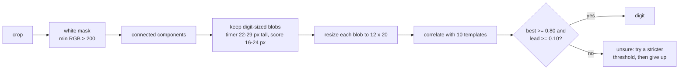

# 3. Reading the HUD

Code: `pipeline/digits.py` (template matching), `pipeline/read_hud.py` (two-pass reader).
Output: `readings.jsonl`, one line per second:

```json
{"i": 1631, "t": 1631.0, "spike": false, "timer_raw": "0:29", "timer": "0:29",
 "decimal": false, "score_l": 2, "score_r": 12, "ocr": 0, "filled": true}
```

This chapter is the biggest speed-up in the project: **reading the 1h45m VOD went from ~25 minutes
to 16 seconds with the same result.** The method generalises to any fixed-font overlay.

## Baseline: general-purpose OCR

The first version used RapidOCR (PaddleOCR models on ONNX Runtime) on every crop: a text
**detection** model finds text boxes, then a **recognition** model reads them. Valorant's digits on
a translucent panel over a moving background are hard for it, so each crop was tried up to three
ways (upscaled, contrast-enhanced, white-only mask).

Cost: **~0.72 s of CPU per frame** (timer + two scores, with retries). For 6,370 frames that is
~77 CPU-minutes, ~25 minutes on 6 workers. Worse, frames with **no HUD** (menus, lobby, dead time)
were the most expensive, because every retry failed.

## Template matching

The digits are white, always the same font, and (after scaling to 1080p) always the same size. So
instead of asking a general model "what text is here?", ask "which of these ten digit shapes does
this blob look like?":



1. **Mask**: keep pixels whose smallest RGB channel is above 200 (white, not just bright). If that
   fails, retry at 225 and 245, which handles bright backgrounds bleeding through the panel.
2. **Blobs**: OpenCV connected components; keep those with a digit's height and width. The colon
   and decimal point are too small and drop out naturally.
3. **Normalise**: resize each blob to 12 x 20, subtract the mean, scale to unit length.
4. **Match**: a dot product with ten unit-length templates gives a correlation per digit. Accept
   only if the best is >= 0.80 **and** leads the runner-up by >= 0.10. Otherwise report "unsure"
   instead of guessing.
5. **Assemble**: timer = 3 blobs read as `M:SS` (and rejected if impossible, like "1:67"); 4 blobs
   = the decimal "31.67" pill; score = 1 or 2 blobs.

Cost: **~0.3 ms per frame**, about 2,000 times faster than OCR.

### Where the templates come from: let the slow model label the data

There was no hand-labelled dataset. But the OCR baseline had already produced readings for all
6,370 frames of the sample. `python -m pipeline.digits <hud.npz> <readings.jsonl>` builds the
templates from them: for every frame where OCR read N digits **and** the blob finder found N blobs,
each blob is labelled with its digit, and each template is the average of its blobs (between 250
and 3,300 examples per digit). The result is a 19 KB file, `pipeline/digits.npz`.

When the two methods disagreed on a score, the crops showed the **template reader was right** and
OCR was wrong (it read 2 as 7 and 6 as 9).

> Lesson: a slow, general model is a fine labeller for a fast, specialised one. Averaging many
> noisy labels into a template also averages away most of the labeller's mistakes.

## The hybrid reader: fast path first, OCR only where it adds information

Templates alone could not read every in-game frame (bright skies behind the HUD, motion blur).
Dropping those frames would lose real information, but running OCR on every frame the templates
missed was slow. The final reader runs in two passes:

**Pass 1, every frame**: template matching only. Sub-millisecond; the whole video in seconds.

**Between passes**, cheap logic decides where OCR is actually needed:

- **Context gating**: only frames within 10 s of a confident HUD reading are "in game". Dead time
  never reaches OCR (it used to be the most expensive part).
- **Neighbour inference**: a missing timer between two readings that agree (counting down by one a
  second, or frozen) is filled in. A missing score between two equal scores within 30 s takes that
  value, since scores only change at round end.

**Pass 2, only what is left**: OCR, in a process pool, on just the missing fields.

The OCR itself was then made cheaper too:

- **Recognition only**: the digits are always in the same box, so skip the text-detection model
  and run only recognition on the box (`DIGIT_BOX`): ~19 ms instead of ~318 ms per field.
- **No full-OCR fallback**: on 200 sampled frames where the fast recogniser failed, full OCR also
  failed on **every one (109 of 109)**, while costing ~0.7 s each. So it was removed.

The journey on the 1h45m sample, each step verified against the baseline timeline:

| Version | Frames needing OCR | Reading time |
|---|---|---|
| OCR on every frame | 6,370 | ~25 min |
| Templates, OCR when templates unsure | 1,668 | 4.5 min |
| Two passes, context gating (no inference yet) | 2,634 | 10.5 min |
| + neighbour inference and score filling | 1,248 | 4.3 min |
| + recognition-only on the digit box | 1,248 | 2.4 min |
| + drop the full-OCR fallback | 1,248 | **16 s** |

Note the third row: one "improvement" made it **slower**. Measuring every step is what caught it.

### Bugs found by comparing against the baseline

Each change was checked by re-segmenting and diffing games, rounds, segments and timeouts against
the OCR-only result. That diff caught:

- **A fake round** from "1:67": the reader missed one blob of the "31.67" pill and produced an
  impossible time, which the state machine took as a new round. Fixed by rejecting impossible
  timers (seconds tens digit > 5).
- **Shifted boundaries** (3-6 s) after skipping redundant score OCR: frames left without a score
  stopped counting as "in game". Fixed by filling the score instead of leaving it blank.

> Lessons: (1) build the regression harness (here: segment and diff against a known-good run)
> before optimising; (2) make the fast path say "unsure" instead of guessing, and decide separately
> where a fallback is worth its cost; (3) when a fallback rarely succeeds, measure its success rate.
> Zero out of 109 means delete it.

## Spike icon and decimals

Not everything needs reading. The spike icon is detected by colour: more than 250 strongly red
pixels in the timer crop (R > 170, G < 70, B < 70). One- or two-second spike "blips" are discarded
as noise; a real plant shows the icon for many seconds. The red/teal decimal pill ("31.67") is
flagged as `decimal` and never parsed as a time.
