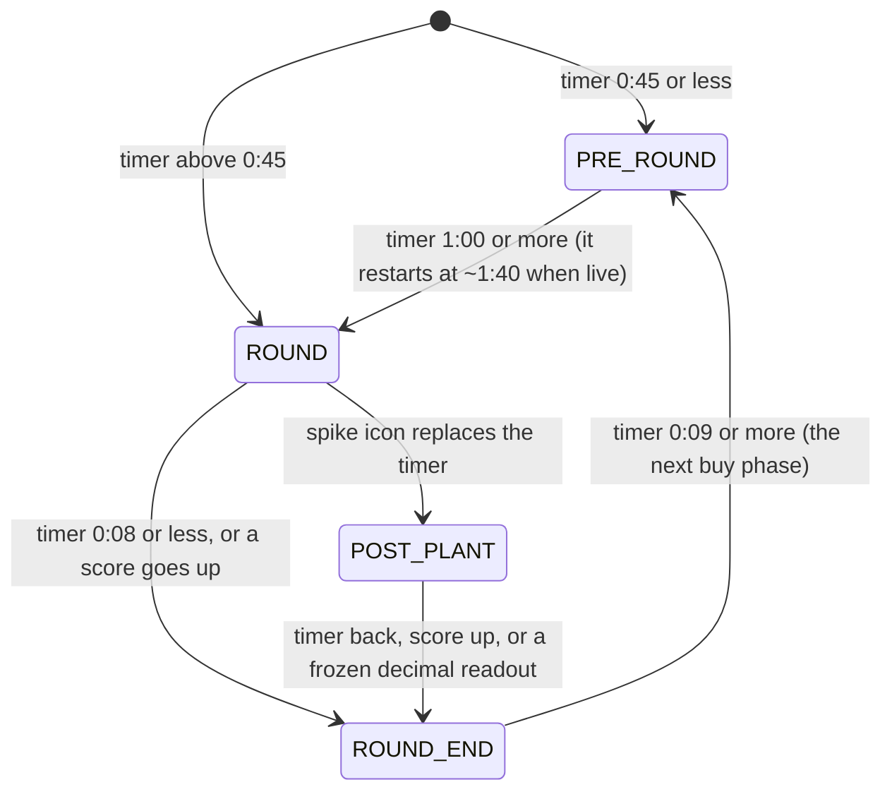

# 4. From readings to rounds

Code: `pipeline/segment.py`. Input: `readings.jsonl` (one reading per second). Output:
`segments.json`.

Per-second readings are noisy: a misread digit here, a missing score there, a second of OCR seeing
"0.26" in a "0:26". The segmenter turns that time series into clean, contiguous segments. It is
plain Python with no machine learning: a few cleaning passes, then a state machine.

## Cleaning passes

Run before the state machine, each fixing one observed failure:

| Pass | Rule | Why |
|---|---|---|
| `drop_isolated_decimals` | a lone "decimal" reading between two normal timers is a normal timer | OCR reads `0:26` as `0.26` on a single frame |
| `drop_short_spikes` | spike icon visible for fewer than 3 consecutive seconds is noise | red flashes (abilities, damage) trip the colour check |
| `stable_scores` | a score only starts when 4 of the next 7 readings agree, and only ever changes by **+1**, confirmed by 4 readings in a row | misreads ("9" for "6") and missing readings |
| `confirmed` (timer) | a timer reading is trusted only if the next valid reading agrees with a countdown (within 3 s) | one-frame misreads that would start a phase |

The +1 rule for scores is domain knowledge doing the work: a score in a round-based game can only
go up by one at a time, so any other jump is noise by definition.

> Lesson: encode the invariants of the domain (scores go up by one, a countdown decreases by one a
> second, a plant lasts many seconds). They remove most noise for free.

## Finding games

A frame "has HUD" if it has a timer or spike plus a score, or both scores. A **game** is a run of
HUD frames; 12 or more consecutive seconds without HUD ends it, and runs shorter than 20 seconds are
dropped. Everything between games is `NON_GAME` (menus, lobby, map loading, the stream's intro).

## The round state machine

Within each game, a state machine walks the readings once:



How it reads the HUD:

- **Buy phase** (`PRE_ROUND`): the timer counts down from ~0:30. A trusted timer of 1:00 or more
  means the round has gone live (it jumps to ~1:40).
- **Live** (`ROUND`): the timer counts down from 1:40. A spike icon means a plant.
- **Post-plant** (`POST_PLANT`): the icon replaces the timer for up to 45 s.
- **Round end** (`ROUND_END`): the post-round countdown never exceeds ~0:08, so a trusted timer
  <= 0:08 while live, or a confirmed score increase, ends the round. A timer >= 0:09 afterwards is
  the next buy phase, and the round number increments.
- The round number starts at `left + right + 1` from the first confirmed score, so a recording that
  starts mid-game still numbers rounds correctly.

Two details that took iteration:

- **Score bumps lag.** The score confirmation needs 4 readings, so the bump can arrive a few seconds
  after the timer already ended the round. An `expected` counter remembers "this round end was
  detected by the timer; its score bump is still to come", so the late bump does not end a second,
  phantom round.
- **The score of a round** is read once the round is **live**, not when its buy phase starts. At
  the start of the buy phase, the previous round's result may not have settled on the HUD yet; by
  the time the round goes live it has. (Reading it at the buy phase made the last rounds of a game
  show no result.)

## Timeouts

A timer stuck on the same value for 5 or more consecutive readings (not counting a spike) is a
**pause**: a tactical or technical timeout, usually in the buy phase. Two stuck stretches with the
same value no more than 6 s apart are one pause (a few unreadable frames inside a timeout must not
split it). 8 s was tried and wrongly merged two real, separate timeouts.

## Remakes

In scrims, a game is sometimes started, played for a round or two, then abandoned and restarted.
One sample had two such "games" before the real one: one round played, the timer frozen at 0:06
for 13 minutes, then back to the lobby; then 28 seconds of a buy phase, and the lobby again.

`drop_restarts`: a game of **at most 4 rounds that is followed by a new game starting at 0-0** is
a remake and becomes dead time. Both conditions matter:

- A stream that simply ends during its last game is kept (nothing follows it).
- One real game split in two by a long HUD gap is kept (its second half does not restart at 0-0).

## Output format

```json
{
  "duration": 10582.4,
  "games": [{"game": 1, "start": 1717.0, "end": 4584.0, "rounds": 24, "our_side": "l",
             "final": [11, 13], "status": "finished", "result": "loss"}],
  "segments": [{"game": 1, "round": 7, "phase": "POST_PLANT", "start": 2318.0, "end": 2338.0,
                "score": [4, 14], "result": "loss", "label": "POST_PLANT_7"}],
  "pauses": [{"start": 4224.0, "end": 4319.0, "timer": "0:10"}]
}
```

`score` is `[left, right]` as shown on the HUD. Which side is "us", and the `result` fields, come
from chapter 5.

## How it was validated

The segmenter has no unit tests with synthetic data. Instead, every change to the reader or the
segmenter was checked on the real 1h45m VOD against the known-good baseline: number of games and
rounds per game, every segment's phase and round, boundary differences > 2 s, and every pause. The
final pipeline matches the baseline on games, rounds and segments; a handful of boundaries differ by
3 to 9 seconds (at game ends and one round handoff), and pause starts by up to 10 s.

> Lesson: for a time-series state machine, a "golden" real recording plus a structural diff is a
> better test than synthetic cases. It catches the interactions you did not think of.
