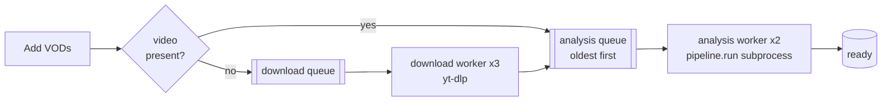

# 6. The app

Code: `app/main.py` (API), `app/jobs.py` (job pools), `app/db.py` (SQLite), `app/static/`
(frontend).

The computer vision is useless if adding a video, waiting for it and reviewing it is painful. This
chapter covers the engineering around the pipeline.

## Shape

- **FastAPI** serves a small JSON API, the video files and the static frontend from one process.
- **SQLite** (`data/library.db`) holds one row per VOD: name, status (`queued`, `processing`,
  `ready`, `failed`), current stage and percentage, error, source URL, dates. Results live in files
  (`segments.json`), not the database.
- **No frontend build step**: plain HTML, CSS and JavaScript.

## How the page and the server talk

Three kinds of traffic:

| Kind | When | Requests |
|---|---|---|
| **Actions** | you click something | `POST /api/vods` (upload), `POST /api/vods/from-url`, `PATCH /api/vods/{id}` (rename), `POST /api/vods/{id}/reprocess`, `DELETE /api/vods/{id}` |
| **Reads** | you look at something | `GET /api/vods/{id}` (a VOD's breakdown, once when opened), `GET /api/vods/{id}/video` (range requests while playing), `GET /api/vods/{id}/thumb.jpg` |
| **Status poll** | on a timer | `GET /api/vods`: every VOD's status, step, percentage, summary and dates |

After an action the page refreshes at once rather than waiting for the poll. The poll exists for
changes **the server makes on its own**: a download or analysis progressing, finishing or failing,
and background upgrades of older VODs. The server has no way to tell the page about those, so the
page asks.

### The polling schedule

| Situation | Check every |
|---|---|
| something is uploading, queued or processing | 2 s |
| nothing in progress | 15 s (background updates still arrive) |
| the tab is hidden | not at all; one check as soon as it is visible again |
| the app is not answering | 1 s, with a "Lost contact… reconnecting" banner |

Adding a VOD switches to the 2-second rhythm at once. One check returns ~1.4 KB and takes the
server ~3 ms with three VODs, all on the same machine. The trade-off of the idle rhythm: if the app
is closed while the page sits idle, the banner can take up to 15 s to appear.

### Why polling and not push

The alternative is a long-lived connection over which the server pushes changes (Server-Sent Events
or WebSockets). For a single local user with jobs that take minutes, polling wins:

- **simpler**: an ordinary request on a timer, no connection to keep alive or re-establish;
- **restarts are free**: after the app restarts, the next check simply works;
- **fast enough**: progress every 2 s is plenty.

What would change the answer: many users, large libraries, or anything that must feel instant (for
example several people editing notes on the same round). Then: server push, or at least "nothing
changed" responses (ETag / `304 Not Modified`) and changes-since queries instead of the full list.

> Lesson: polling is a legitimate design for single-user, slowly changing state. Make it adaptive
> (fast while work is running, slow when idle, paused when nobody is looking) and refresh at once
> after the user's own actions.

## Job pools: parallel, ordered, isolated

- **Two pools**: up to 3 downloads (network-bound) and 2 analyses (CPU/GPU-bound) at once
  (`COACH_DOWNLOADS`, `COACH_PARALLEL`). A finished download goes straight into the analysis queue.
- **Order**: the analysis queue is a priority queue keyed on when the VOD was added, so VODs are
  processed in the order added even when downloads finish out of order. It started as a plain FIFO
  in download-finish order; the UI promised "in the order added", so the server had to make that
  true.
- **Isolation**: each analysis is a separate `python -m pipeline.run` process. A crash, a native
  library fault or a memory spike kills only that job.
- **Memory guard**: while a job runs, the worker checks free memory twice a second and kills the
  job's whole process tree if it drops below `MIN_MB` (default: the smaller of 4 GB and 10% of RAM).
  Replaced an earlier bash watchdog so it works on Windows too.
- **Progress**: the pipeline writes `progress.json` (stage, percentage) atomically (write to a temp
  file, then rename); the worker copies it into the database once a second. Downloads parse
  yt-dlp's progress lines (with their own `PCT` marker, because yt-dlp strips the template's type
  prefix; that bug made progress stick at 0% early on).
- **Cancel**: deleting a VOD removes its row first, then kills its running process (if any) and
  waits for the worker to release the folder before deleting it. A VOD still waiting in a queue is
  simply skipped by the worker that picks it up (it checks the row still exists).
- **Resume**: on startup, anything `queued` or `processing` is queued again, oldest first. Partial
  downloads resume; a partial analysis reuses its cached scan if present.

The per-CPU OCR worker count is split between concurrent analyses so two jobs do not each start a
full set of workers.

> Lesson: separate network-bound and compute-bound stages into different pools, run untrusted or
> heavy work in subprocesses, and make the user-visible promise (here: "in the order added") an
> explicit property of the scheduler.

## Background upgrades

New features often need data old VODs do not have. Rather than asking the user to re-process:

- **Scores per segment**: added later; older breakdowns are re-segmented from their saved
  `readings.jsonl` in under a second the first time they are opened.
- **Remakes**: `drop_restarts` runs on every breakdown when read (it is idempotent), so older VODs
  are cleaned up too.
- **Round and game results**: `segments.json` carries `results_version`; at startup a background
  thread re-runs the results step on VODs with an older version (~20-60 s each).
- **Match dates**: a background thread asks YouTube for the stream's date (no re-download) or reads
  the file's recording time for VODs that lack one.

The library list reports each breakdown's modification time, and an open viewer reloads its data in
place when that changes, so a background upgrade shows up without a refresh. That was a real bug
first: a VOD opened during the 20 s after startup kept showing no wins and losses.

> Lesson: version derived data and upgrade it lazily or in the background. Keep enough of the
> intermediate data (readings) that upgrades are cheap.

## Dates

"Today" in the library was replaced by when the match was played:

- **YouTube**: `release_timestamp` (when a stream started) or `timestamp`, fetched with the title in
  the same yt-dlp call. Labelled "Streamed" for past live streams, else "Published". Shown in local
  time: a stream on the evening of Mar 2 in the US is Mar 3 in UTC.
- **Files**: the `creation_time` in the video's metadata (OBS writes one; stored as UTC), else the
  file's last-modified time, which the browser sends with the upload.

## The frontend

Three views, switched by the URL hash (`#/` library, `#/vod/<id>` viewer):

- **Library**: thumbnail cards (title; W/L chips per game with game and round counts; the match
  date), search, sort, and the processing queue. Each queue row shows a 4-segment bar (download or
  copy in, scan, find rounds, results) with the current step filling, so a finished download does
  not look like a finished VOD. Finished rows show "Ready" for 6 s, then leave the queue.
- **Add dialog**: tabs for video files (marked fastest) and YouTube links (one input per link, each
  validated), both feeding one list; "Process N VODs".
- **Viewer**: built around rounds. Game tabs with W/L, a compact round list (score, W/L, plant mark,
  length), and under the video a round bar: previous/next round, the round's phases as buttons (keys
  1-4), and a round clock on the game's own 1:40 timer that can be clicked to jump.

Design choices that came from feedback:

- **One accent colour means "where you are"**; everything else is neutral. Per-phase colours were
  removed as noise. Green and red are reserved for won and lost, amber for the spike.
- **Lengths read "45s" / "1m 04s"** and positions read like the game's clock ("Round clock 1:12"),
  so nothing looks like an ambiguous timestamp.
- The whole-VOD timeline was removed from the viewer: the round list and round clock are the
  navigation, and the browser's own scrubber remains for anything else.

Robustness details:

- **`Cache-Control: no-cache`** on all pages and assets, plus a version tag on the asset links. Without
  it, a browser kept an old `app.js` and `style.css` after an update and showed an unstyled page.
- **A "Connecting" state** until the API first answers, and a "Lost contact... reconnecting" banner if
  it stops; the page never mistakes "not reachable yet" for "empty library".
- **Defensive data handling**: a round with only some phases (seen in a remade game) once crashed the
  viewer halfway through switching VODs, leaving one VOD's video under another's rounds. Round
  building now tolerates missing phases, and a breakdown that fails to load returns to the library
  with a message instead of mixing two VODs.

> Lesson: treat "loading", "unreachable" and "empty" as three different states in the UI.
